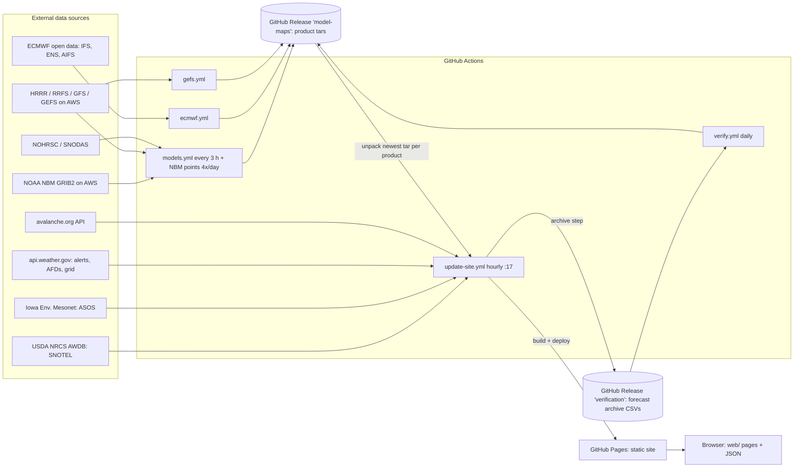
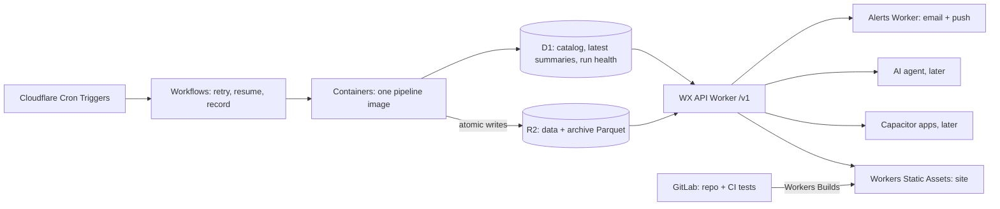

# Architecture

How Snow-Wx works **today** (commit `bf8f8ac`, GitHub Actions + GitHub Pages) and **where it is going** (GitLab + Cloudflare,
`docs/specs/platform-transition.md`). File paths and field names are taken from the code; when this doc and the code disagree,
the code wins: fix this doc in the same merge request.

---

## 1. The system in one picture (today)



**Key property:** every product is built by a separate job and published as a tar on the `model-maps` release; the hourly
`update-site` job downloads the newest tar per product, fetches observations, builds `build/`, archives forecasts and deploys the
whole site. Sources fail independently: a failed source keeps its last-good file where possible and is reported in `meta.json`.

**Known weaknesses** (all in `docs/BACKLOG.md`): GitHub delivers few scheduled runs here; a failed release listing can deploy a
site without products (H4); the archive upload can delete the only copy of a month (C1); outputs are not written atomically (M15);
on a fresh runner a failed alerts/avalanche fetch has no last-good copy (H3).

---

## 2. Pipeline CLI (`python -m pipeline <cmd>`)

| Command | What it does | Default output | Run by |
|---|---|---|---|
| `build` | copy `web/` → `build/`, run all observation sources | `build/` | `update-site.yml` |
| `obs [--only …]` | observation sources only | `build/data` | dev |
| `points` | NBM point forecasts for every ski area (+ SNOTEL sites) | `build/data/points/` (pass the folder itself) | `models.yml` (points entry) |
| `models --model hrrr\|rrfs\|gfs` | model maps **(being removed)** + HRRR/RRFS/GFS plume and ridge sampling | `build/models/<model>/` | `models.yml` |
| `ecmwf` | ECMWF HRES line, ENS plume, AIFS line | `build/models/ecmwf/` | `ecmwf.yml` |
| `gefs` | NOAA GEFS plume | `build/models/gefs/` | `gefs.yml` |
| `nohrsc` | NOHRSC snowfall + SNODAS overlay layers | `build/data/nohrsc/` | `models.yml` |
| `ndfd` | NWS NDFD at areas and SNOTEL sites (archive only, not shown) | `build/data/ndfd/` (deleted before deploy) | `models.yml` |
| `archive` | append forecasts + SNOTEL obs to the verification archive | `verification` release | `update-site.yml` |
| `archive-check` | archive integrity (columns never change, rows only grow) | stdout / exit code | dev, CI |
| `verify` / `verify-ci` | score archived forecasts vs SNOTEL | `build/models/verify/` | `verify.yml` |
| `restore` | restore last-good SNOTEL from the live site before a build | `build/data` | `update-site.yml` |
| `catalog` | rebuild `data/ski_areas.json` (OpenSkiMap + 3DEP + NWS/NBM joins) | `data/` | dev, on demand |
| `pages`, `og`, `pwa`, `stub`, `r2-plan`, `linkcheck`, `webcams` | W1/W2/W4 tooling, built but off or dev-only | various | dev / at W1 |

Observation sources are registered in `pipeline/__main__.py:SOURCES` (`alerts`, `afd`, `avalanche`, `hazards`, `snotel`, `asos`);
each has `run(cfg, session, outdir) -> dict` and fails independently. `product_status()` writes per-source health to `data/meta.json`;
`pipeline/monitor.py` turns it into GitHub issues.

---

## 3. Data products and contracts

Contracts consumed by the web pages. **Adding** a field is safe; renaming or removing one needs a human decision and a check of every
consumer (`grep -rn "<field>" web/js pipeline tools tests`).

### 3.1 NBM point forecast — `build/data/points/<id>.json`

```
id, name, tz, source, cycle (YYYYMMDDHH), liquid_cycle, issued, generated_at,
times[], fhours[],
area { catalog record without nbm_grid/osm_id/verify },
summary { tag, sentence, bullets, confidence, rule_ids }        # Daily Snow (pipeline/summary.py)
points {
  summit|base {
    elev_ft, grid_elev_ft, grid [i, j],
    series   { hourly values: temperature, wind, snow level, SLR, … },
    precip   { hourly/6-h QPF and snowfall },
    periods  [ 12-h day/night periods 00Z–12Z / 12Z–00Z: temps, snow type, snow_lo/hi/q1/q3 … ],
    days     [ 12Z–12Z days: expected snow, likely p25–p75 from native 24-h windows ],
    totals   { 24h|48h|72h|7d|10d: snow_in, snow_lo, snow_hi, snow_q1, snow_q3, qpf_in, qpf_lo, qpf_hi,
               p_snow, native (bool), extended (bool), range ("NBM 10-90" | "derived 25-75" | null), from },
    exceed   { window → P(≥ 4/8/12 in) from NBM's own exceedance fields, mean, cell_mean }
  }
}
```
- `native: false` → show the expected amount only, never a range (hard rule 4). 7/10-day totals never carry a range.
- `summary.json` (all areas: `cycle`, `quality`, `issued`, compact rows for Finder/My mountains) and `exceed_summary.json`.
- SNOTEL-site forecasts `snotel-<triplet>.json` use the same shape; their **pages** are being removed, the **files and archive rows
  stay** (verification, M11/M12; review H6).

### 3.2 Observations and safety — `build/data/`

| File | Producer | Contents |
|---|---|---|
| `snotel.geojson` (+ station files) | `snotel.py` | SNOTEL depth, SWE, changes, temps; stale ≤ 48 h flagged |
| `asos.geojson` | `asos.py` | ASOS/AWOS currents (IEM) |
| `avalanche.geojson`, `avalanche_ratings.json` | `avalanche.py` | zones and ratings; `expired` computed at build time, `end_date` present (H2: also check in the browser) |
| `alerts/index.json` (+ per-alert text) | `alerts.py` | active NWS alerts matched to areas; `generated_at` |
| `afd/index.json` | `afd.py` | latest Area Forecast Discussion per office |
| hazards layer data | `hazards.py` | NWS winter hazard products for the obs map |
| `nohrsc/…` | `nohrsc.py` | snowfall analysis and SNODAS overlays |
| `meta.json` | `__main__.product_status()` | per-source health: ok, error, last_success_at, consecutive failures |
| `search.json` | `search.py` | header search index |

### 3.3 Model plumes — `build/models/`

| Path | Producer | Notes |
|---|---|---|
| `<hrrr\|rrfs\|gfs>/…` precip and ridge samples, merged into `multimodel.json` | `models/run.py` → `models/multimodel.py`, `models/ridge.py` | written only if ≥ 1 map PNG rendered today (H5: decouple) |
| `ecmwf/…` | `ecmwf.py` | HRES line, ENS members, AIFS line; partial cycles tagged (M9) |
| `gefs/index.json` + per-area files | `gefs.py` | member plume; resume cache in `data_cache/gefs/<cycle>` (M8) |
| `verify/` | `verify.py` | `verification.json`, per-site files, `run.json` (never an `index.json`: the map catalog collects those) |
| `<model>/<cycle>/<field>/<domain>/fNNN.png`, `index.json` | `models/plot.py` | **model maps — being removed** |

### 3.4 Forecast archive (`verification` release) — `docs/verification.md`

Monthly CSVs of every forecast cycle's 24/72-h windows at areas and SNOTEL sites, plus SNOTEL observations. **Append-only**
(columns never change; dev23 added `slr_p25/p50/p75` at the end of NBM files). It is the input to M9 verification, M11 and M12.

---

## 4. Web front end (`web/`)

Plain HTML/CSS/JS, no build step; Plotly, Leaflet and MapLibre are self-hosted in `web/vendor/`.

| Page | Main script(s) | Purpose |
|---|---|---|
| `index.html` | `app.js`, `points-canvas.js`, `overlays.js`, `basemap*.js`, `hazards.js`, `snotel-status.js` | observations map |
| `area.html` | `area.js` (~1,360 lines: split before big UI work), `charts/*`, `multimodel.js`, `ensemble.js`, `summary-ui.js`, `freshness.js`, `verification-ui.js` | ski-area forecast page |
| `finder.html` | `finder.js` | find areas by expected snow (name to be replaced, set by owner) |
| `mine.html` | `mine.js` | favourites ("My mountains") |
| `status.html` | `status.js` | data status per source |
| `about.html`, `sources.html` (generated by `tools/gen_site_pages.py` from `config/sources.yml`), legal drafts | — | methods, credits, drafts (`noindex`) |
| `models.html` | `models.js` | model-map viewer — **being removed** |

Shared: `colors.js` (single NWS snowfall table, danger colours), `charts/theme.js` (`C.plot`, `C.summary`, `C.legend`, table toggle),
`search.js`, `site-config.js` (feedback address from config), `analytics.js` (off), `pwa.js` (off).
The browser contacts only the site itself, USGS tiles, OpenFreeMap and the NOAA hazards layer (enforced by the `privacy` browser check).

---

## 5. Configuration and catalogs

- `config/settings.yml` — region, windows, thresholds, feature flags (on/off list in `docs/STATUS.md`), monitoring limits, site origin/base path.
- `config/models.yml` — model products, cycles, fields (map entries go with the trim; keep a sampling-only block).
- `config/sources.yml` — every source with licence and credit (drives `sources.html`).
- `config/summary_rules.yml` — Daily Snow rules and thresholds.
- `config/ski_areas.yml` — manual catalog fixes. `data/ski_areas.json` (ODbL), `data/snotel_points.json` — committed catalogs.

---

## 6. Tests and checks

- `tests/` — ~69 pytest modules, all offline (`tests/fakes.py` FakeSession; autouse fixtures keep tests out of the real `data_cache`).
  Some test JS through node (`test_*_js.py`). Guards worth knowing: `test_no_business_content.py`, `test_ecmwf_wording.py`,
  `test_hygiene.py`, `test_ndfd_not_deployed.py`, `test_lean_charts.py`, `test_plotly_vendor.py`.
- `tools/browser_check.py` — headless-Chrome checks (38 in the full run) on a private build copy with frozen inputs
  (`tools/browser_fixtures.py`); three still read live data until PR B (M19).
- `infra/scheduler/` — `node --test` (19 tests).

---

## 7. Target architecture (platform move)



What changes for code: no `GITHUB_OUTPUT`, release tars, Actions cache or `gh` calls (review §6 lists every coupling); outputs go to a
staging prefix then a `latest` pointer; caches and output roots become configurable; run health moves from GitHub issues to D1 +
notifications. Order and gates: `docs/ROADMAP.md` and `platform-transition.md` §10.
