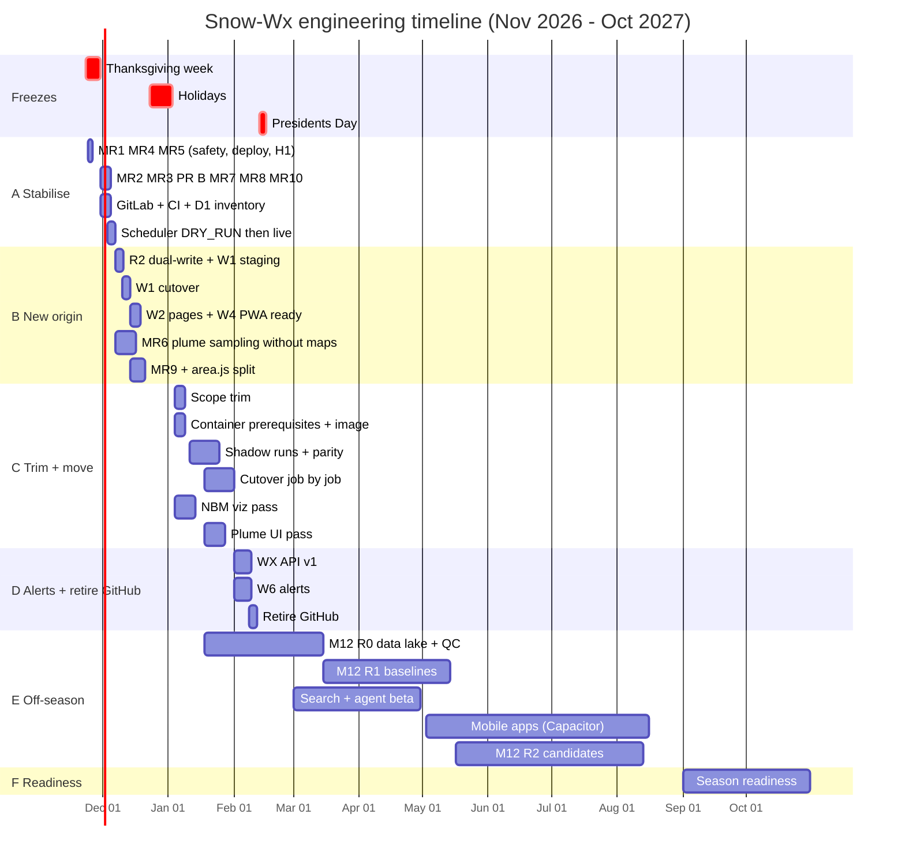

# Roadmap: next steps, timeline and action items

The engineering plan from **Mon Nov 23 2026** to the **2027–28 season**. This file owns the **dates and action items**
(`A-NN`). `docs/BACKLOG.md` owns the **work item detail** (review findings, effort); `docs/specs/platform-transition.md` owns the
**platform phases**; `docs/specs/ml-postprocessing.md` owns the **M12 gates**. If they disagree on a date, this file wins: fix the other.

**Team:** Dev A = pipeline · Dev B = API + infra · Dev C = web + mobile · Owner = flags, accounts, authorisations, anything
"set by owner" (`CONTRIBUTING.md`). Capacity assumption: each developer ~4 productive days/week; adjust in the Monday planning.

**Freezes (fixes only):** Thanksgiving week (Nov 23–29), **Dec 23 – Jan 2**, **Feb 13–15**. Never cut over a pipeline job during a storm.

---

## 1. Phases at a glance

| Phase | Dates | Goal | Exit criteria |
|---|---|---|---|
| **A. Stabilise** | Nov 23 – Dec 6 | Safety and data-loss fixes; GitLab + CI; reliable schedules | MR 1–5, 7, 8, 10 + PR B merged; scheduler live; GitLab is the primary remote with CI tests |
| **B. New origin** | Dec 7 – Dec 22 | Site on Cloudflare (W1), indexable pages (W2), PWA (W4); plume sampling decoupled | Custom domain serving the site; `pages` and `pwa` enabled by the owner; MR 6, MR 9 merged |
| — Freeze | Dec 23 – Jan 2 | Holiday traffic | On-call only |
| **C. Trim + move** | Jan 4 – Jan 31 | Scope trim; pipeline on Cloudflare Containers; NBM + plume UI passes | All jobs cut over after shadow runs; trim acceptance (PLAN §8.3) met; UI passes merged |
| **D. Alerts + retire GitHub** | Feb 1 – Feb 15 | WX API v1, W6 alerts, GitHub retired | Test alert by email + push within one points run; GitHub archived (redirect stub only) |
| **E. Off-season build** | Feb 16 – Aug 31 2027 | M12 research (R0–R2), search + AI agent beta, mobile apps | M12 R2 report; agent beta; apps in TestFlight / internal testing |
| **F. Season readiness** | Sep – Oct 2027 | Hardening, load tests, launch items set by owner | Readiness review passed |
| **G. 2027–28 season** | Nov 2027 → | M12 experimental line (R3), public verification | R3 shipped behind its flag; season verification running |

---

## 2. Action items

Status: ○ open · ◐ in progress · ✅ done (date) · ✗ dropped (reason). "Set by owner" items are prerequisites only; their decisions
are tracked privately. Backlog IDs in brackets.

### Phase A — Stabilise (Nov 23 – Dec 6)

| ID | Action | Owner | Due | Depends on | Done when | Status |
|---|---|---|---|---|---|---|
| A-01 | Review and merge the docs reorganisation branch `docs/reorg-2026-11` | Team | Tue Nov 24 | — | merged to `main`; everyone re-reads PLAN, AGENTS, ROADMAP | ○ |
| A-02 | **MR 1 safety display** [C2, H2, M12, N1] | Dev C | Wed Nov 25 | — | danger chips readable on 5 levels; expiry at view time; expired alerts hidden; alert age shown; credits added; browser assertions | ○ |
| A-03 | **MR 4 no silent empty deploy** [H4] | Dev B | Wed Nov 25 | owner authorises the `update-site.yml` edit | empty listing fails the build; products keep `last_success_at` | ○ |
| A-04 | **MR 5 6-h window fix** [H1, M3, M4] | Dev A | Wed Nov 25 | — | 01Z/13Z fixture test past f036 passes; snow-level gap ≠ P(snow)=1; per-field quality gate | ○ |
| A-05 | Owner authorisations for workflow edits needed in Phase A (A-03, A-10, A-12) | Owner | Tue Nov 24 | — | written in the MRs | ○ |
| A-06 | **MR 3 archive cannot lose a month** [C1, M13] | Dev B | Wed Dec 2 | — | temp-upload → delete → rename + dated backup; failure test; `archive` source monitored | ○ |
| A-07 | **MR 2 safety data on fetch failure** [H3] | Dev A + Dev C | Thu Dec 3 | A-02 | last-good alerts/avalanche/AFD restored (stale-flagged); "not available" notice + center/NWS links | ○ |
| A-08 | **PR B** frozen snowy + dry Alta fixtures; `tools/live_smoke.py` [M19] | Dev C | Wed Dec 2 | — | browser suite 38/38 with no live data | ○ |
| A-09 | GitLab group (owner creates); push from the fresh clone (never "Import from GitHub"); GitHub becomes a push-mirror target | Dev B | Tue Dec 1 | A-01; GitLab group set by owner | all devs cloned from GitLab | ○ |
| A-10 | `.gitlab-ci.yml` (pytest, browser `--quick`) + one self-hosted runner | Dev B | Fri Dec 4 | A-09 | MRs show a green test check | ○ |
| A-11 | **MR 7 pin the environment** [H7] | Dev B | Fri Dec 4 | — | lock file per platform; dev tools split out; CI uses the lock | ○ |
| A-12 | **MR 8 workflow hardening + M14** [M10, M11, M14] | Dev B | Fri Dec 4 | A-05 | inputs via `env:` + validation; per-job permissions; SHA pins; scheduler sends per-slot inputs | ○ |
| A-13 | Cloudflare organisation account, member roles, environment-scoped tokens | Owner + Dev B | Mon Nov 30 | account set by owner | token list (names/scopes only) in `infra/README.md` | ○ |
| A-14 | Deploy the external scheduler: `DRY_RUN` 24 h, then live against GitHub (platform 0.3) | Dev B | Tue Dec 8 | A-12, A-13 | 3 days of on-time dispatches; on-time share recorded in STATUS | ○ |
| A-15 | D1 inventory: export schema, split catalog/app DBs, migrations, staging + prod (platform 0.5) | Dev B | Fri Dec 4 | A-13 | schema + migrations in `infra/d1/`; `docs/specs/data-model.md` written | ○ |
| A-16 | **MR 10 wording** [M1, M2, M5] | Dev A + Dev C | Fri Dec 4 | A-04 | summary names the actual window; lead buckets fixed; no "likely" envelope | ○ |
| A-17 | Custom domain available for W1 | Owner | Fri Dec 4 | set by owner | DNS on Cloudflare | ○ |

### Phase B — New origin (Dec 7 – Dec 22)

| ID | Action | Owner | Due | Depends on | Done when | Status |
|---|---|---|---|---|---|---|
| A-18 | R2 buckets (`data` staging/prod, `archive`); workflows **dual-write** to R2 + release assets (platform 1.1) | Dev A + Dev B | Wed Dec 9 | A-13, A-11 | fresh data in R2 every cycle | ○ |
| A-19 | W1 staging on Workers Static Assets reading `data.<domain>`; CSP fix [M17] | Dev C | Thu Dec 10 | A-17, A-18 | parity test + Lighthouse not worse on staging | ○ |
| A-20 | Workers Builds connected to GitLab (MR previews) (platform 1.5) | Dev B | Fri Dec 11 | A-09, A-13 | push to `main` deploys; MR gets a preview URL | ○ |
| A-21 | **W1 cutover** + GitHub Pages redirect stub; rollback rehearsed (`docs/ops/w1_cutover_checklist.md`) | Dev C + Dev B | Mon Dec 14 | A-19, A-20; owner go-ahead | custom domain live; old URLs redirect | ○ |
| A-22 | Fix W2 redirect loop [H8]; owner enables `pages` (W2) | Dev C | Wed Dec 16 | A-21 | ~160 prerendered pages, sitemap submitted | ○ |
| A-23 | Network-first safety data in the service worker [M16]; owner enables `pwa` (W4) | Dev C | Fri Dec 18 | A-21 | airplane-mode test on iOS + Android passes | ○ |
| A-24 | Analytics wired to the provider (set by owner); owner enables `analytics` | Dev C | Fri Dec 18 | A-21 | events visible; privacy page updated | ○ |
| A-25 | **MR 6 plume sampling without maps** [H5]; record H6 | Dev A | Fri Dec 18 | A-04 | `precip.json`/`ridge.json` written without rendering; `load_points` moved; badge unchanged | ○ |
| A-26 | **MR 9 ensemble gaps, GEFS, ECMWF partials** [M6, M7, M8, M9, N2] | Dev A + Dev C | Tue Dec 22 | A-08 | gaps never bridged; run times on every line; caches atomic | ○ |
| A-27 | Split `web/js/area.js` into modules (safety header, snow charts, plumes, observations) | Dev C | Tue Dec 22 | A-02, A-07 | no behaviour change; browser suite green | ○ |

### Phase C — Trim + pipeline move (Jan 4 – Jan 31)

| ID | Action | Owner | Due | Depends on | Done when | Status |
|---|---|---|---|---|---|---|
| A-28 | **Scope trim**: remove model maps, Sno-Parks, SNOTEL-site pages (keep SNOTEL-site forecasts) | Dev A + Dev C | Fri Jan 8 | A-25 | PLAN §8.3 "Scope trim" acceptance met; before/after size in STATUS | ○ |
| A-29 | Container prerequisites: atomic outputs [M15], configurable output/cache roots, JSON results instead of `GITHUB_OUTPUT` (platform 2.0) | Dev A + Dev B | Fri Jan 8 | A-11 | `python -m pipeline <cmd>` runs in the image, writes atomically | ○ |
| A-30 | `pipeline/Dockerfile`; image built in GitLab CI (platform 2.1) | Dev A | Fri Jan 8 | A-10, A-11 | image runs every command locally | ○ |
| A-31 | Cron → Workflows → Containers in staging; D1 `runs` table (platform 2.2) | Dev A + Dev B | Wed Jan 13 | A-14, A-15, A-30 | all jobs run on schedule in staging | ○ |
| A-32 | Shadow runs ≥ 7 days per job + `tools/parity.py` (platform 2.3) | Dev A | Fri Jan 22 | A-31 | parity green; ≥ 99 % cycles on time | ○ |
| A-33 | Cut over job by job: verify → gefs → models-points → points → ecmwf → update-site (skill `snow-wx-pipeline-cutover`) | Dev A | Fri Jan 29 | A-32 | prod reads only Cloudflare-produced data; GitHub jobs disabled, not deleted | ○ |
| A-34 | Archive to R2 (versioned), Parquet copy; `verify` reads Parquet (platform 2.5) | Dev B | Fri Jan 22 | A-06, A-18 | scores match the CSV path | ○ |
| A-35 | Monitoring via D1 `source_health` + notifications to on-call (platform 2.6) | Dev B | Fri Jan 22 | A-31 | test alert received | ○ |
| A-36 | **NBM visualization pass** on the area page | Dev C | Fri Jan 15 | A-27 | design reviewed by owner; hard-rules check passed | ○ |
| A-37 | Verification panel v0 ready; owner enables `verification_ui` when the minima are met | Dev A + Dev C | Fri Jan 15 | A-16 | panel on staging with M2 fixed | ○ |
| A-38 | **Plume UI pass** (multi-model lines, ECMWF ENS / GEFS plumes, badge) | Dev C | Fri Jan 29 | A-26, A-36 | skill `snow-wx-plume-chart` rules met | ○ |
| A-39 | M12 R0 kick-off: NBM backfill job design + `pipeline/qc/` skeleton with tests | Dev A | Fri Jan 29 | A-29 | design note + first QC stage tested | ○ |

### Phase D — Alerts, API, retire GitHub (Feb 1 – Feb 15)

| ID | Action | Owner | Due | Depends on | Done when | Status |
|---|---|---|---|---|---|---|
| A-40 | WX API v1 + OpenAPI; contract tests (`docs/specs/api.md`) | Dev B | Wed Feb 10 | A-33, A-15 | `/v1` endpoints live behind cache | ○ |
| A-41 | **W6 alerts** on the new stack: magic link, preset alert, web push, Queues | Dev B + Dev C | Wed Feb 10 | A-23, A-40 | test alert by email + push within one points run; double opt-in; one-click unsubscribe | ○ |
| A-42 | Retire GitHub: remove the push-mirror, archive the repo, then delete or make private; keep a 12-month redirect-stub repo | Owner + Dev B | Fri Feb 12 | A-33 | only the stub remains on GitHub | ○ |
| A-43 | One-page "leave Cloudflare" runbook (`docs/ops/`) | Dev B | Fri Feb 12 | A-33 | runbook reviewed | ○ |

### Phase E — Off-season (Feb 16 – Aug 31 2027)

| ID | Action | Owner | Due | Depends on | Done when | Status |
|---|---|---|---|---|---|---|
| A-44 | M12 **R0** complete: NBM point backfill (v4.0–v5.0) + hourly SNOTEL history + QC v1 + gold set | Dev A (+ a meteorologist for labels) | Mon Mar 15 | A-39 | QC acceptance gate (`ml-postprocessing.md` §4.4) | ○ |
| A-45 | M12 **R1** baselines report (raw NBM vs QC'd SNOTEL; quantile mapping; CSGD) | Dev A | Fri May 14 | A-44 | internal report; go / narrow-to-SLR / stop decision | ○ |
| A-46 | Place search (client index + D1 FTS5) → AI Search over docs/AFDs → agent beta with guardrail eval set | Dev B + Dev C | Fri Apr 30 | A-40 | eval set passes in CI; capped beta (access set by owner) | ○ |
| A-47 | Mobile apps (Capacitor): bundled build, native push, widgets, offline favourites, location | Dev C | Fri Aug 13 | A-41 | TestFlight / internal testing builds | ○ |
| A-48 | M12 **R2** ML candidates (pooled quantile model; leave-season/site-out) | Dev A | Fri Aug 13 | A-45 | CRPSS > 0 vs best baseline out of sample in most regions | ○ |
| A-49 | Retrain/recheck after any NBM upgrade; record version drift | Dev A | as needed | — | note in `ml-postprocessing.md` | ○ |

### Phase F–G — Readiness and next season

| ID | Action | Owner | Due | Depends on | Done when | Status |
|---|---|---|---|---|---|---|
| A-50 | Season-readiness review: load test, restore drill, on-call rota, dependency updates, Lighthouse | Team | Thu Sep 30 2027 | — | checklist passed | ○ |
| A-51 | M12 **R3** experimental "Snow-Wx adjusted" line behind `ml_adjusted.enabled=false` | Dev A + Dev C | Nov 2027 | A-48 | owner enables for staff, then public with label + model card | ○ |

---

## 3. First 10 working days by person

| Day | Dev A (pipeline) | Dev B (API + infra) | Dev C (web + mobile) |
|---|---|---|---|
| Mon Nov 23 | Onboarding; run `points` for one cycle | Onboarding; read workflows + scheduler | Onboarding; run browser checks |
| Tue Nov 24 | A-01 review; start A-04 (H1 test) | A-01 review; start A-03 (H4) | A-01 review; start A-02 (C2, H2) |
| Wed Nov 25 | A-04 MR open | A-03 MR open | A-02 MR open |
| Thu–Fri Nov 26–27 | Thanksgiving (on-call only) | Thanksgiving (on-call only) | Thanksgiving (on-call only) |
| Mon Nov 30 | A-07 (H3 pipeline half) | A-13 Cloudflare roles/tokens; A-06 (C1) | A-08 PR B |
| Tue Dec 1 | A-07 | A-09 GitLab push; A-06 | A-08 |
| Wed Dec 2 | A-16 (M1, M2) | A-06 MR open; A-11 (H7) | A-08 MR open; A-07 (H3 web half) |
| Thu Dec 3 | A-07 MR open | A-12 (M10, M11, M14) | A-07 web; A-16 (M5) |
| Fri Dec 4 | A-16 MR open; plan A-25 | A-10 CI, A-15 D1 inventory | A-16; prep A-19 |

---

## 4. Dependencies on the owner (dates needed)

| Needed by | Item | Blocks |
|---|---|---|
| Tue Nov 24 | Authorise workflow edits for A-03, A-12 (and A-10 runner) | A-03, A-12, A-14 |
| Mon Nov 30 | Cloudflare organisation account; GitLab group | A-09, A-13, A-14, A-18 |
| Fri Dec 4 | Custom domain (set by owner) | W1 (A-19, A-21) and everything after |
| Fri Dec 18 | Analytics provider (set by owner) | A-24 |
| Dec 14 – Dec 18 | Flip `pages`, `pwa`, `analytics` after each check passes | W2, W4, W5 |
| Mid-Jan | Flip `verification_ui` when the minima are met | A-37 |
| Feb | AI agent access model and budget; app store accounts (set by owner) | A-46, A-47 |

---

## 5. Operating cadence

- **Monday planning:** walk this file; move dates honestly; assign the week's action items; check the weather (major storms → no risky deploys).
- **Friday demo:** merged work; update `docs/STATUS.md`, this file and `docs/BACKLOG.md`.
- **On-call rotation:** weekly, starting Mon Nov 30 (Dev B → Dev A → Dev C); covers the pipeline health alerts and the status page.
- **Monthly:** review risks (§6) and the cut list.

## 6. Risks to the timeline

| Risk | Signal | Response |
|---|---|---|
| Domain or accounts late | A-17 / A-13 not done by Dec 4 | Keep improving on GitHub Pages; W1 moves to Jan 4–8; W2/W4 follow |
| Safety fixes take longer than S/M | A-02, A-07 slip past Dec 4 | They still go first: push A-26/A-27 into January |
| H5 decoupling harder than expected | A-25 slips past Dec 18 | Trim (A-28) waits; never delete map code before plume sampling stands alone |
| Container limits or cost surprise | shadow runs fail or cost > estimate | Same image on a small VPS with a systemd timer (platform §5.1 fallback) |
| Storm cycles during cutover | active warnings over major regions | Pause cutovers; shadow runs continue |
| Team capacity (holidays, illness) | ≥ 2 days lost in a week | Cut in this order: W7 → storm-total tracker → obs-map perf → W6 to off-season |

**Never cut:** safety fixes (MR 1–2), archive durability (MR 3), W1, W2, W4, analytics, pipeline monitoring, NBM + plume UI.

## 7. Keeping this file true

- When an action item finishes: status ✅ + date here, and the matching BACKLOG row.
- When a date moves: change it here with a one-line reason under the table in the same commit.
- New action items take the next free `A-NN`; never reuse an ID.
