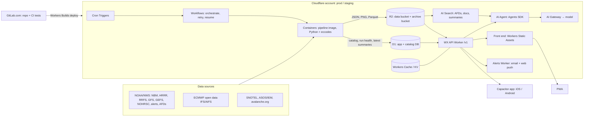

# Snow-Wx: Platform Transition Plan (GitHub → GitLab + Cloudflare)

> **Version 1.2, Nov 23 2026.** Written for the team of 3 developers moving Snow-Wx from a solo GitHub project to its own platform (GitLab + Cloudflare).
> **v1.1 scope update (team decision, Nov 23):** model maps removed; Sno-Parks removed; forecast pages for **ski areas only (~160)**; **SNOTEL kept as observations**; UI focus is **NBM visualizations + model plumes**. The model *point sampling* behind the plumes (HRRR, RRFS, GFS, ECMWF, GEFS) stays. Numbers below are updated for ~160 forecast points (was ~1,444).
> **v1.2 (Nov 23, after the code review):** Phase 0 now starts with the review's safety and data-loss fixes; the scheduler is deployed only after review M14/M10 are fixed; forecasts at SNOTEL sites stay computed and archived (H6). Work items and their order: `docs/BACKLOG.md`.
> Builds on `PLAN.md` v1.3, `docs/archive/STATE_SNAPSHOT-2026-11-21.md`, `docs/specs/hosting-seo.md`, `docs/specs/alerts-backend.md` and the team's architecture sketch (`basic_architecture_plan.png`).
> **[verify]** = re-check at the source before you spend money or sign up. Cloud prices and limits change often. Figures here were checked on Nov 23 2026.
> This is not legal, tax or financial advice.

---

## 0. TL;DR

| Decision | Recommendation | Why (one line) |
|---|---|---|
| **Database** | **Keep D1** for relational and app data (catalog, users, favorites, alert rules, entitlements, run health, search index). **Put forecast and observation time series in R2** (JSON for the site, Parquet for the archive). Use **Postgres through Hyperdrive** only if a trigger in §3.4 fires. | D1 is a good small SQL database. Even at ~160 ski areas, hourly forecasts × 6 model sources × 8 cycles a day add up to tens of millions of row writes a month, and history would grow without limit. R2 has no egress fees, and the site already reads one JSON file per point. |
| **Git host** | **GitLab.com, Free tier, private group** (3 seats fits under the 5-user cap). Upgrade to Premium only when a paid feature is worth it. | Cloudflare Workers Builds supports GitLab directly. Codeberg is ruled out: its terms are for FOSS, not private commercial code, and since 2026 they bar projects that are mostly AI-generated. |
| **CI** | **GitLab CI for tests only** (pytest, browser suite, lint). **Deploys** through Cloudflare Workers Builds. | Free GitLab has 400 compute minutes a month: enough for tests, far too little for the data pipeline. |
| **Data pipeline ("Python Scripts" + "GitHub Actions" boxes)** | **Move it off the git host.** Run it as **one Docker image** on **Cloudflare Containers**, started by **Cron Triggers → Workflows**. Fallback: the same image on a small VPS. | This fixes the unreliable GitHub schedules (about 6 of 46 hourly runs delivered, 1 ECMWF scheduled run ever). It also stops tying the pipeline to whichever git host you use. |
| **Front end** | **Workers + Workers Static Assets** on the custom domain. This replaces the "Cloudflare Pages" plan in W1. | Cloudflare now recommends Workers over Pages for new projects. The limit is 100k files per version on the paid plan, against 20k on Pages. |
| **WX API** | One **TypeScript Worker** (`api.<domain>/v1`) reading R2 + D1, behind Workers Cache. The website, mobile app and AI agent all use it. | One contract for every client; external data feeds can reuse it later. |
| **Search engine** | **Two different things:** place search (a client-side index or D1 FTS5, about 1,000 rows: ski areas + SNOTEL stations) and text retrieval for the agent (**Cloudflare AI Search**). | Place search is too small to need a search service. AI Search is GA and works with R2. |
| **AI agent** | **Cloudflare Agents SDK**. Its tools call the WX API, and model calls go through **AI Gateway**. Ship as a labelled beta. | Structured tools give answers that carry their source. Hard rules 1–2 must hold inside the agent too. |
| **Mobile** | **PWA first** (already built). Then a **Capacitor** wrapper with real native features (push alerts, home-screen widget, offline favorites, location), in the 2027 off-season. | Apple rejects plain website wrappers under guideline 4.2. Push alerts (W6) are the native feature that justifies an app. |
| **Timing** | Move hosting and git in **Dec**, observe the freeze Dec 23–Jan 2, move the pipeline in **Jan** in shadow mode, turn off GitHub in **Feb**. AI and mobile come after the season's main milestones (timing set by owner). | Peak-season traffic. Never cut over a pipeline during a storm without a parallel run. |

**Expected run-rate:** about **$20–45/month** before AI usage and before any GitLab Premium seats (§9). Budget limits are set by owner.

---

## 1. Where we are today (Nov 23 2026)

From `PLAN.md` §2 and `STATE_SNAPSHOT.md`:

- **Site:** GitHub Pages project site (`alexluke23.github.io/snow-wx/`), about 5.4k files / 302 MB after dev23. Repo `alexluke23/snow-wx` is **public**.
- **Pipeline:** Python (`pipeline/`) run by **7 GitHub Actions workflows**: `update-site` (hourly), `models` (every 3 h), `ecmwf` (about 1.3 GB per run), `gefs`, `verify` (daily), `tests` (PRs), plus artifacts published as **Release assets**.
- **Known pain:** GitHub delivers few scheduled runs. An external scheduler Worker (`infra/scheduler/`) is **built but not deployed**.
- **Database:** a **Cloudflare D1** (SQLite) database exists (team note). **Action in Phase 0:** inventory its schema and contents. They are not documented in the project yet.
- **Built but off:** W2 prerendered pages, W4 PWA, share cards, analytics, verification UI, W6 alerts skeleton (D1/KV-based), W7 wind flag.
- **Open owner decisions that this plan resolves or forces:** §11 items 1 (name + domain), 5 (hosting move), 6 (private vs public repo), 8 (external trigger), 12 (history purge / refs/pull).

### 1.1 What the team's sketch says, and what this plan changes

```
Data Sources → Python Scripts → Database → WX API → Front End Website → App Wrapper → Android / iPhone
                     │                 └→ Search Engine → AI Agent
                     └→ GitHub Actions                      (App Wrapper also calls WX API)
```

The sketch is sound. This plan keeps every box and makes four changes:

1. **"GitHub Actions" becomes "Scheduler + Pipeline runtime"** on Cloudflare. GitLab CI only runs tests.
2. **"Database" splits into three stores by data shape:** D1 (relational), R2 (files and time series), KV/Cache (hot reads).
3. **"Search Engine" splits into two:** place search and agent retrieval.
4. **"App Wrapper" calls the WX API and bundles the front end.** It does not load the website remotely (Apple 4.2).

---

## 2. Target architecture



### 2.1 Product-by-product roles

| Box in sketch | Cloudflare product | Role | Notes |
|---|---|---|---|
| Python Scripts | **Containers** | Runs the existing `pipeline` CLI unchanged inside a Docker image | Largest instance (standard-4) = 4 vCPU / 12 GiB / 20 GB disk. ECMWF (~1.3 GB per run) fits. |
| GitHub Actions (schedule) | **Cron Triggers + Workflows** | Fires on the existing cron strings, starts the right container job, retries failed steps, records outcomes | Paid plan allows 250 cron triggers per account (free: 5). |
| Database | **D1** | Relational data (§3) | Already in use. |
| Database (bulk) | **R2** | Points JSON, obs, model-map frames, forecast archive (Parquet) | Zero egress. 10 GB-month free, then $0.015/GB-month. |
| WX API | **Workers** | Read API, auth, rate limits, caching | TypeScript (Hono or plain). |
| Front End Website | **Workers Static Assets** | HTML/CSS/JS shell + prerendered area pages | Replaces the Pages plan in `hosting-seo.md`. |
| Search Engine | **AI Search** (+ D1 FTS5 or a client index) | §6 | |
| AI Agent | **Agents SDK + AI Gateway** (+ Workers AI or an external model) | §7 | |
| App Wrapper | **Capacitor** (not Cloudflare) | §8 | |
| (new) Alerts | **Workers + Queues + Email Service / web push** | W6 | Spec already assumes Worker + D1. |

---

## 3. Database recommendation

### 3.1 Short answer

**Keep Cloudflare D1, but only for the data it suits.** Pair it with **R2** for everything that is big, append-only or file-shaped. Don't move to another database now: nothing in the current workload needs one, and D1 already sits inside your stack.

### 3.2 Why not put the forecasts in D1

Rough size if forecasts were stored as rows (after the Nov 23 trim to ski areas only):

| Item | Estimate |
|---|---|
| Forecast points | **~160 ski areas** × base + summit ≈ **320** sample points |
| Hourly steps to day 10–11 (NBM) | ~240–264 |
| NBM rows per cycle (one wide row per point-hour) | ≈ **80,000** |
| Plume sources per area (HRRR, RRFS, GFS, ECMWF HRES, ECMWF ENS ~50 members (read from the file), GEFS 31 members, AIFS) | ensemble members multiply rows ~80× |
| Rows written per month (NBM 8×/day + plumes 4×/day) | ≈ **20M (NBM) + several hundred million (members)** |

The trim makes NBM-only storage in D1 *possible* (inside the 50M included writes), but the plumes, which are now a focus, are ensemble-heavy and don't fit the row model. And history still grows without bound.

D1 limits and prices checked Nov 23 2026:

- **Workers Paid:** 50M rows written included per month, then **$1.00 per million**. **Free:** 100,000 rows written per **day**, after which queries are blocked until the reset.
- **10 GB maximum per database** (500 MB on Free). D1 is built to scale out across many small databases.
- **100 bound parameters per query** and a 2 MB row limit, so bulk loads need batching.
- A single database queues concurrent requests and returns "overloaded" when the queue fills.

Meanwhile the front end, PWA cache and prerendered pages are already built around **one JSON file per point** (plus the multimodel/ensemble JSON for plumes). Writing those files to R2 is cheaper and faster, and needs no front-end rewrite.

### 3.3 What goes where

| Data | Store | Format / key | Writer | Readers |
|---|---|---|---|---|
| Catalog: ski areas, SNOTEL/ASOS sites (observation stations), NWS grid joins, avalanche zones | **D1** `catalog` tables | rows | pipeline (on catalog change) | API, search, agent |
| Latest **summary** per ski area (daily summary text, 24/48/72 h expected, P(≥ X), snow level, agreement badge, issue time) | **D1** `point_latest` (one row per area, upsert) | ~160 rows per cycle ≈ 40k writes/month | pipeline | API (Finder, My mountains, alerts), agent |
| Latest **SNOTEL obs** per station (depth, 24/48/72 h change, SWE, temp, obs time) | **D1** `snotel_latest` (upsert) | ~836 rows per hour ≈ 0.6M writes/month | pipeline | API, alerts (storm totals), agent |
| Full NBM point forecast (hourly + periods) | **R2** `data/points/<id>.json` | JSON < 150 KB | pipeline | front end, API passthrough, PWA |
| NBM forecasts at SNOTEL sites (verification only, no pages; review H6) | **R2** `data/points/snotel-<triplet>.json` + archive rows | JSON | pipeline | verification, M11/M12 |
| Plume data (multimodel lines, ECMWF ENS / GEFS members) | **R2** `data/plumes/<id>.json` | JSON | pipeline | front end, API |
| Obs map layers (SNOTEL, ASOS, avalanche, hazards), NOHRSC + NBM overlays | **R2** `data/layers/…` | JSON / PNG | pipeline | front end |
| Forecast **archive** and verification inputs | **R2** archive bucket | **Parquet**, partitioned `year=/month=/source=` | pipeline | verify job (DuckDB in a container), optional Basin SQL |
| Run health / source freshness / status page | **D1** `runs`, `source_health` | rows | pipeline, Workflows | status page, monitor, alerts |
| Users, magic-link tokens, favorites, alert rules, entitlements, API keys | **D1** `app` database (separate DB) | rows | API, payment webhook | API, alerts Worker |
| Alert send log, rate-limit state | **D1** `app` (or a Durable Object per user if contention appears) | rows | alerts Worker | alerts Worker |
| Hot responses (e.g. `/v1/summary`) | **Workers Cache** | HTTP cache | API | API |
| Feature flags (`pages.enabled`, `pwa.enabled`, …) | Config in repo now; **KV** or Flagship later | — | deploy | front end, API |

**Two D1 databases, not one:** `snowwx-catalog` (rebuildable from the pipeline) and `snowwx-app` (user data, backed up, never rebuilt). This keeps the user data small and safe and lets you wipe or rebuild catalog data freely. D1 Time Travel gives point-in-time restore for 30 days on Paid. Still add a **nightly export of `snowwx-app` to R2**.

### 3.4 When to add Postgres (escape hatch)

Add a managed Postgres (Neon, Supabase or Timescale Cloud [verify pricing]) **through Hyperdrive** only if one of these happens:

1. `snowwx-app` passes **5 GB** or write contention shows up (overloaded errors) at peak.
2. External data consumers need **ad-hoc SQL over the historical archive** that DuckDB-on-Parquet can't serve fast enough.
3. You need cross-user transactional features beyond D1's model (e.g. complex billing).

Until then, a second database is a second thing to run, back up and pay for. Not worth it for 3 people in season one.

### 3.5 Phase 0 database tasks

- [ ] Export the current D1 schema (`wrangler d1 export --no-data`) into `infra/d1/schema/`; document every table in `docs/specs/data-model.md`.
- [ ] Split into `snowwx-catalog` and `snowwx-app` if both kinds of data share one database today.
- [ ] Put all schema changes in **migrations** (`migrations/0001_*.sql`, applied by Wrangler). Never edit tables by hand in prod.
- [ ] Create **staging and prod** databases per name (4 in total). Local development uses Miniflare's local D1.
- [ ] Turn on the nightly `snowwx-app` export to R2 and test a restore once.

---

## 4. Leaving GitHub

### 4.1 Options compared

| Option | Cost for 3 devs | CI | Cloudflare deploy integration | Fit |
|---|---|---|---|---|
| **GitLab.com Free** (private group) | $0 | 400 compute min/month on shared runners, or unlimited on your own runner | **Native** (Workers Builds + Pages) | **Recommended** |
| GitLab.com Premium | $29/user/month ≈ $87/month [verify] | 10,000 min/month | Native | Later, if you need required MR approvals, more minutes, etc. |
| Self-hosted Forgejo / GitLab CE | VPS ~$5–20/month + your time | Forgejo Actions / GitLab CI on your runner | External CI + Wrangler | Only if self-hosting is itself a goal |
| Codeberg | $0 | Woodpecker/Forgejo Actions | External | **No:** private commercial code is outside its purpose, and since mid-2026 its terms bar projects mostly written with AI tools. This repo is built largely with Claude Code. |
| Bitbucket | Free/Standard | Pipelines | **No native Workers Builds**; needs external CI | Weaker fit |
| Cloudflare **Artifacts** (Git-compatible, connects to Workers Builds) | — | — | Native | **Watch only:** closed beta; confirm access before relying on it |

GitLab.com Free facts to plan around [verify on signup]:
- **5-user limit per private top-level group.** Fine for 3 devs. A 6th person (contractor, designer) forces Premium or a public group.
- Accounts created after Jan 27 2026 get **3 top-level groups**. Use one group `snow-wx` with subprojects.
- **400 compute minutes/month** on shared runners; extra minutes are $10 per 1,000.
- **10 GiB storage** per namespace. Keep data out of git (it already is).

### 4.2 Repository layout (monorepo)

Keep one repo. Three developers work faster when one MR can change the pipeline output and the API that reads it.

```
snow-wx/
├─ pipeline/            # Python (unchanged package) + Dockerfile
├─ api/                 # WX API Worker (TypeScript)
├─ web/                 # front end (static assets) + prerender output target
├─ alerts/              # W6 alerts Worker (cron + queue consumer)
├─ agent/               # AI agent Worker (Agents SDK)      ← Phase 4
├─ mobile/              # Capacitor project                  ← Phase 5
├─ infra/
│  ├─ scheduler/        # existing Cron Worker → becomes the Workflows entry point
│  ├─ d1/migrations/    # catalog + app migrations
│  └─ terraform/        # Cloudflare resources as code (optional, recommended by Phase 3)
├─ config/              # settings.yml, webcams.yml, … (unchanged)
├─ tests/  tools/  docs/
└─ .gitlab-ci.yml
```

### 4.3 Moving the code safely

The Nov 21 history rewrite removed private planning docs from history. GitHub still keeps 25 `refs/pull/*` refs that only GitHub Support can clear. **Moving off GitHub settles this item for good, if done right:**

1. From the **fresh clone** (`D:\Snow Weather\snow-wx-new`), confirm `git log` matches the rewritten history (153 commits) and `git for-each-ref` shows **no** `refs/pull/*`.
2. Create the GitLab project **empty** (no README) and set it **Private**.
3. `git push gitlab main` + `git push gitlab --tags` + any live branches by name.
   - **Do not use GitLab's "Import from GitHub".** It imports pull requests as merge requests and would bring the purged content back through `refs/pull/*`.
   - Do not use `git push --mirror` from an old clone that ever fetched pull refs.
4. Copy **open issues/PR notes by hand** if any are worth keeping; there were few.
5. Re-clone on every dev machine from GitLab (also required by the purge).
6. Set GitHub to **archive / read-only**. Then delete the repo or make it private once the redirect stub (§5.4) lives elsewhere. This settles §11 item 12.
7. Re-create secrets in **Cloudflare** (Workers secrets / Secrets Store) and in **GitLab CI variables** (masked, protected). Don't copy them from GitHub; rotate them all (NOAA/ECMWF have no keys, but the GitHub fine-grained token, `HEALTHCHECK_URL`, etc. do).

### 4.4 Team workflow (3 developers)

| Area | Primary owner | Backup |
|---|---|---|
| Pipeline, data sources, verification (`pipeline/`, Containers, R2 layout) | Dev A | Dev B |
| API, D1 schema, alerts, auth, payments (`api/`, `alerts/`, `infra/`) | Dev B | Dev A |
| Front end, prerendered pages, PWA, mobile, agent UI (`web/`, `mobile/`, `agent/`) | Dev C | Dev B |

Conventions:
- **Protected `main`.** All changes go through merge requests, with at least 1 reviewer by team rule. GitLab Free has optional approvals; *required* approval rules are a Premium feature [verify].
- **CODEOWNERS** file mapping the table above (GitLab reads `CODEOWNERS`; enforcement needs Premium [verify]).
- **Trunk-based:** short branches (< 3 days), feature flags for unfinished work (pattern already used: `*.enabled`).
- **Environments:** `local` (Miniflare/`wrangler dev`) → **preview per MR** (Workers Previews) → `staging` (own D1/R2/Workers) → `prod`.
- Keep `PLAN.md` as the single plan. Add an **ADR folder** (`docs/adr/NNNN-title.md`) for each decision in §0.
- **Deploy freezes stay:** Thanksgiving week, Dec 23–Jan 2, Presidents' Day (Feb 13–15).

### 4.5 CI on GitLab

`.gitlab-ci.yml` stages:

| Stage | Job | Runs on | Est. minutes |
|---|---|---|---|
| test | `pytest` (offline, ~2 min today) | every MR | 2–3 |
| test | `browser --quick` (~1.5 min) | every MR | 2–3 |
| test | `api` / `alerts` unit tests (Vitest + Workers pool) | MRs touching `api/`, `alerts/` | 1–2 |
| test | full browser suite (~5 min) + WebKit/Firefox smoke | `main` + nightly | 6–8 |
| build | pipeline Docker image → registry | `main` when `pipeline/` changes | 3–5 |
| smoke | `tools/live_smoke.py` against staging, then prod | after each deploy | 1 |

Budget: ~40 MRs/month × ~6 min ≈ 240 min + nightly ≈ **350–450 min/month**. That's right at the free limit. **Plan:** register **one self-hosted GitLab Runner** (any dev's spare machine, or a $5/month VPS) for the heavy browser jobs. Shared minutes then only cover light jobs, and the team never stalls on minutes.

The nightly smoke run also closes the gap found in the Nov 23 models-page hotfix ("nothing smoke-tests the deployed site").

**Deploys** don't use CI minutes: Workers Builds (Cloudflare's builder, 3,000 build minutes/month free) deploys `web/`, `api/`, `alerts/` on push to `main`, and posts commit statuses back to GitLab.

---

## 5. Replacing GitHub Actions and GitHub Pages

### 5.1 Pipeline runtime: Cloudflare Containers

**Why containers rather than Workers:** the pipeline needs eccodes/cfgrib, Herbie, xarray, GB-scale downloads and minutes of CPU. That is outside the Workers runtime (128 MB memory, limited CPU). Containers run any Linux image and bill CPU only while active.

Design:

1. **One image**: `pipeline/Dockerfile` (Python 3.12 + the existing requirements). Every job is `python -m pipeline <command>`, exactly as the workflows call it today. **The image is the unit of portability.** If Containers ever disappoints, the same image runs on any VPS, Fly.io or Cloud Run with a systemd timer.
2. **Orchestration:** the existing `infra/scheduler/` Worker (crons copied from the workflows, drift test, due rule + grace) becomes the **Cron Trigger → Workflow** entry point. Each Workflow step: start container job → wait → verify outputs → write `runs` row in D1 → notify on failure.
3. **Storage instead of Release assets:** jobs write straight to **R2** (`r2.enabled=true`, `pipeline r2-plan` already exists). The "unpack newest tars" step in `update-site` goes away: R2 *is* the newest state.
4. **Resume cache** (ECMWF per-cycle cache) moves from the Actions cache to an R2 prefix `cache/ecmwf/<cycle>/`.
5. **Instance sizes** (start here, measure, adjust):

| Job (today's workflow) | Cadence | Instance | Notes |
|---|---|---|---|
| `obs` (SNOTEL, ASOS, avalanche, hazards) + `build` (update-site) | hourly :17 | standard-1 (½ vCPU, 4 GiB) | Build step shrinks once data lives in R2 |
| `points` (NBM, ~160 areas) | 4×/day | standard-1/2 | ~9× fewer points than before the trim |
| `models-points` (HRRR, RRFS, GFS point sampling for plumes) + NOHRSC | every 3 h | standard-2 (1 vCPU, 6 GiB) | **Map-frame rendering removed Nov 23**; only point sampling remains |
| `ecmwf` HRES+ENS+AIFS | 4×/day | standard-3/4 (8–12 GiB, 16–20 GB disk) | 1.3 GB download is the same whatever the point count; check disk headroom |
| `gefs` | 4×/day | standard-2 | |
| `verify` | daily | standard-1 | DuckDB over Parquet; SNOTEL as ground truth |

6. **Idempotent jobs:** each job writes to a temp prefix and then flips a `latest` pointer (or writes atomically by key), so a retried or killed job never publishes half a cycle. Workflows retries handle the rest. Confirm Containers' max run time and eviction behaviour against the longest job (ECMWF, ~10 min) [verify].

### 5.2 Shadow run and parity test (no cutover without it)

For each workflow, in order **verify → gefs → models-points → points → ecmwf → update-site**:

1. Run the Cloudflare job **in parallel** with GitHub Actions for **≥ 7 days**, writing to the **staging** R2 bucket.
2. Run a parity script (`tools/parity.py`, new) that compares staging outputs with production outputs per cycle: same files, same point IDs, numeric fields equal within float tolerance, same issue times.
3. Compare **delivery reliability:** share of scheduled cycles published on time (target ≥ 99% vs today's GitHub numbers).
4. Cut over by switching which bucket the front end reads (config), not by deleting anything. Keep the GitHub workflow **disabled but present** for 2 weeks as rollback.

### 5.3 Front end hosting: Workers Static Assets (updates W1)

`hosting-seo.md` planned **Cloudflare Pages**. Change it to **Workers + Static Assets**. Cloudflare now recommends it for all new projects, and it lifts the file cap to **100,000 files per version** on Workers Paid (20,000 on Free; 25 MiB per file either way). The W1 checklist (domain, parity test, redirect stub, Lighthouse not worse, rollback) still applies; only the deploy target changes.

- `www.<domain>` / apex → Worker with static assets (`web/`), including ~160 prerendered `/ski/<state>/<id>/` pages (W2). With model-map frames, Sno-Park pages and SNOTEL forecast pages gone, the build drops well below the 20,000-file Free limit, so the file cap stops being a design constraint.
- Old links: `#<snopark-id>` and `models.html` redirect to the Finder / home page (Worker redirect rules), so no 404 trail.
- `data.<domain>` → R2 custom domain (public read, cache rules).
- `api.<domain>` → WX API Worker.
- Security headers: the draft `_headers` file becomes Worker-applied headers. Keep the CSP test.

### 5.4 The old GitHub Pages URL

GitHub Pages can only serve a static stub (meta-refresh + canonical). To keep inbound links and SEO working, keep **one tiny public repo** (`snow-wx-redirect`, no code, no history) serving the stub for **12 months**, then retire it. That is the only GitHub dependency left after Phase 3. If you prefer a clean break, accept broken old links; traffic to the old URL is still small.

### 5.5 What changes about the "public repo = free minutes" assumption

`PLAN.md` §7 notes the public repo gets free Actions minutes. After the move the repo is **private** (settles §11 item 6). Compute is now a small Cloudflare bill (§9) instead of free-but-unreliable GitHub minutes.

---

## 6. WX API

### 6.1 Shape

- One Worker, `api/`, TypeScript, versioned under `/v1`. Publish an **OpenAPI spec** (`api/openapi.yaml`). The web, mobile and agent clients, and later external API consumers, are generated from or checked against it.
- **Read endpoints** (public, cached):
  - `GET /v1/points/{id}`: full forecast (proxied from R2, `Cache-Control` set to the next cycle).
  - `GET /v1/points/{id}/summary`: from D1 `point_latest`.
  - `GET /v1/points/{id}/plumes`: multimodel lines + ensemble members (from R2).
  - `GET /v1/finder?state=&min_p8=`: Finder queries over `point_latest` (ski areas only).
  - `GET /v1/snotel/{station}` and `GET /v1/snotel/near/{area_id}`: latest SNOTEL obs.
  - `GET /v1/obs/{layer}`, `GET /v1/status`. (No model-map catalog endpoint: model maps removed.)
  - `GET /v1/search?q=`: place search (§6.3).
- **User endpoints** (auth): magic-link sign-in, favorites, alert rules, entitlements (W6 spec).
- **External consumers** (later, set by owner): API keys in D1, per-key rate limits, embed endpoints.

### 6.2 Rules carried into the API (from `PLAN.md` hard rules)

- Every response carries **source(s) and issue time**. Every heuristic field carries a `heuristic: true` label.
- **Safety fields are never gated:** avalanche danger, NWS alerts, snow level / rain-at-base and data freshness are available to anonymous callers.
- No endpoint returns a summed or interpolated percentile across windows (rule 4). Add API contract tests that assert this.
- Attribution strings (NOAA/NWS, ECMWF CC BY 4.0, ODbL) are in the payload so every client can show them.

### 6.3 Search engine (two parts)

1. **Place search** ("Alta", "Mt Hood Meadows", "Snowbird SNOTEL"): ~160 ski areas + ~836 SNOTEL stations ≈ 1,000 records. Ship a **prebuilt client-side index** (a few hundred KB, cached by the PWA, works offline) and mirror it with **D1 FTS5** for `/v1/search` (mobile, agent). No paid search product needed.
2. **Text retrieval for the AI agent** (AFDs, About / "Reading the charts", daily summaries, verification write-ups): **Cloudflare AI Search** over an R2 prefix of Markdown documents. AI Search went GA on Oct 1 2026 with hybrid search on by default. Pricing is usage-based (ingestion tokens, storage, queries) with a free monthly allotment [verify current rates before enabling]. Index only content you're licensed to republish (NOAA public domain, your own docs). **Do not index avalanche.org forecast text** until its commercial terms are confirmed in writing (`BUSINESS.md` §10.1).

---

## 7. AI agent

### 7.1 Design

- **Cloudflare Agents SDK** Worker (`agent/`). State per conversation in a Durable Object (provided by the SDK).
- **Tools = WX API endpoints** (`get_point_forecast`, `get_summary`, `get_plumes`, `find_powder`, `get_alerts`, `get_snotel_obs`, `search_docs`). The agent fetches numbers rather than recalling them. Answers quote the issue time and source.
- **Retrieval:** AI Search for explanatory text only.
- **Model access through AI Gateway** (logging, caching, rate limits, provider switch). Pick the model by testing. Workers AI is cheapest to start with; an external frontier model gives better answers at higher cost [verify pricing].

### 7.2 Guardrails (non-negotiable; mirror `PLAN.md` hard rules)

1. The agent **never issues or paraphrases an avalanche danger rating**. It links to the official center forecast and shows the rating exactly as published.
2. The agent never states a heuristic as a verified accuracy claim. Verification numbers come only from the published verification data.
3. Uncertainty is shown as the "likely" p25–p75 range, never a single confident number.
4. Every answer shows "AI-generated, check the source" and links to the area page.
5. Evaluation set before launch: about 50 scripted questions (storms, rain-on-snow, avalanche-adjacent prompts, out-of-area places) with expected tool calls and forbidden outputs. Run it in CI on agent changes.
6. Cost cap: per-user and global daily limits in AI Gateway. Who gets access first (a capped beta) is set by owner.

---

## 8. Mobile app (App Wrapper → Android / iPhone)

### 8.1 Recommendation

**Ship the PWA first** (W4 is built; enable after the domain move). Build the **Capacitor** apps in the **May–Aug 2027 off-season**, after W6 alerts exist.

This changes the earlier "web/PWA only" stance. Record it as an ADR with the owner's sign-off.

### 8.2 Avoiding the "it's just a website" rejection

Apple rejects apps under **guideline 4.2 (Minimum Functionality)** when the experience isn't different enough from browsing the web. Developers report rejections even after adding small native touches like location or sharing. Plan real native value from day one:

- **Bundle the web build inside the app** (Capacitor `webDir`). Don't point the wrapper at the live URL. Data still comes from the WX API.
- **Native push notifications** for snow and snow-level alerts (APNs/FCM), the main reason to install.
- **Home-screen widgets** (WidgetKit / Android Glance): "next 24 h at my mountains". These are native code, not web.
- **Offline favorites** with background refresh.
- **Location**: "nearest ski areas and SNOTEL stations".
- Optional later: Siri Shortcuts / App Intents ("How much snow at Alta?").

### 8.3 Prerequisites before store submission [verify all]

- Developer accounts (Apple Developer Program, Google Play) and anything sold in the apps: set by owner.
- Privacy "nutrition labels" must match the cookieless analytics and push token use.

---

## 9. Infrastructure costs (monthly, steady state)

| Item | Estimate | Basis |
|---|---|---|
| Cloudflare Workers Paid | **$5** | Includes Workers, D1 (25B reads / 50M writes / 5 GB), KV, Durable Objects, Container allowances |
| Containers (pipeline) | **~$8–20** | ~100 container-hours/month at standard-1…4 mix (lower after the trim: no map rendering, ~9× fewer forecast points; ECMWF download unchanged). Memory beyond 25 GiB-h included at $0.0000025/GiB-s, CPU beyond 375 vCPU-min at $0.00002/vCPU-s (active only), disk beyond 200 GB-h at $0.00000007/GB-s. **Measure in shadow mode; this estimate is the biggest unknown.** |
| R2 | **$0–3** | Site data ~0.3 GB live + archive growth; 10 GB-month free, then $0.015/GB-month; egress free; Class A writes $4.50/M beyond 1M free (each cycle writes ~1.5k–6k objects) |
| D1 | **$0** | `point_latest` + `snotel_latest` upserts ≈ 0.7M writes/month, well inside 50M |
| AI Search / Workers AI / AI Gateway | **$0–20+** | Usage-based; cap with AI Gateway limits |
| GitLab.com | **$0** (Free) / ~$87 (Premium, 3 seats) [verify] | |
| Self-hosted CI runner | **$0–5** | spare machine or small VPS |
| Email sending (alerts) | **$0–10** | Cloudflare Email Service or another provider [evaluate] |
| Domain | ~$1–2 | ~$10–20/year |
| Redirect stub (GitHub Pages) | $0 | 12 months |
| **Total** | **≈ $20–45 / month** | without GitLab Premium and before heavy AI usage |

One-time and annual items (app store accounts, legal review) are tracked privately by the owner.

---

## 10. Phased plan and dates

Peak-traffic windows and freezes from `PLAN.md` §8.2 still apply: **Thanksgiving (Nov 26)**, **freeze Dec 23–Jan 2**, **Presidents' Day (Feb 13–15)**.

### Phase 0: Set up and stabilise (Nov 24 – Dec 5)

| # | Task | Owner | Done when |
|---|---|---|---|
| 0.0 | **Review fixes before anything moves** (`docs/BACKLOG.md` MR 1–4): safety display (C2, H2, M12), safety data on fetch failure (H3), archive durability (C1, M13), no silent empty deploy (H4) | Dev C, Dev A, Dev B | Merged before Thanksgiving traffic |
| 0.1 | Owner decisions: **name + domain** (blocks everything), Cloudflare **organization account** (not personal), GitLab group name | Owner | Domain bought; accounts created with all 3 devs + owner as members |
| 0.2 | Cloudflare account roles: each dev gets their own login. **Scoped API tokens** per environment, never a global key | Dev B | Token list documented in `infra/README.md` (names, scopes, not values) |
| 0.3 | **Deploy the external scheduler** (`infra/scheduler/`, `DRY_RUN` first, then live) **against GitHub**, **after** review M14 (dispatches need per-slot inputs) and M10 (dispatch-input injection) are fixed | Dev B | GitHub workflows fire on time for 3 days. This is the **fastest reliability win**; the code exists, the two fixes are small. |
| 0.4 | Push the repo to GitLab per §4.3; GitHub becomes read-only **mirror target** (GitLab push-mirror → GitHub) so Actions keep running during the move | Dev B | All devs cloned from GitLab; GitHub updates only from the mirror |
| 0.5 | D1 inventory + split + migrations (§3.5) | Dev B | Schema in repo; staging + prod DBs |
| 0.6 | `.gitlab-ci.yml` with pytest + browser `--quick`; self-hosted runner registered | Dev A | MRs show a green test check (also closes the "Checks 0" item in §8.4) |
| 0.7 | Merge **PR B** (frozen fixtures + `live_smoke.py`); drop the Models page from the smoke list | Dev C | Browser suite green without live data |
| 0.8 | **Scope trim** (`PLAN.md` §3 Nov 23): remove Models page + map frames, Sno-Parks, SNOTEL-site forecast pages; **first decouple plume sampling from map rendering (review H5, MR 6)**; keep all SNOTEL obs and the SNOTEL-site forecasts for verification (H6); redirects for old links | Dev A (pipeline) + Dev C (web) | `PLAN.md` §8.3 "Scope trim" criteria met; before/after file count reported. **Do this before Phase 1** so less moves to Cloudflare. |

### Phase 1: Hosting on Cloudflare = W1 (Dec 1 – Dec 20)

| # | Task | Owner | Done when |
|---|---|---|---|
| 1.1 | R2 buckets `snowwx-data-{staging,prod}`, `snowwx-archive`; `r2.enabled=true`; workflows upload to R2 **in addition to** Release assets | Dev A | Fresh data in R2 every cycle |
| 1.2 | Front end on **Workers Static Assets** (staging, then custom domain) reading `data.<domain>` | Dev C | W1 acceptance: parity test, Lighthouse not worse, rollback tested |
| 1.3 | Redirect stub on GitHub Pages → new domain | Dev C | Old URLs land on the right new page |
| 1.4 | Enable in order: `pages.enabled` (W2) → `og_images` → `pwa.enabled` (W4) → `analytics.enabled` | Dev C | Gate 1 (Dec 13) |
| 1.6 | **NBM visualization pass** on the area page (focus area) | Dev C | Owner review on staging |
| 1.5 | Workers Builds connected to GitLab for `web/` | Dev B | Push to `main` deploys; MR gets a preview URL |

**Freeze Dec 23 – Jan 2: fixes only.** The pipeline is still on GitHub Actions (now reliably triggered by 0.3). The site is on Cloudflare.

### Phase 2: Pipeline to Cloudflare Containers (Jan 3 – Jan 31)

| # | Task | Owner | Done when |
|---|---|---|---|
| 2.0 | **Container prerequisites:** pinned environment / lock file (H7), atomic outputs with a staging prefix (M15), kill-safe caches (M8), configurable output and cache roots (review §6) | Dev A + Dev B | `python -m pipeline <cmd>` runs in the image with outputs written atomically |
| 2.1 | `pipeline/Dockerfile`; image built in GitLab CI and pushed to the Cloudflare registry | Dev A | Image runs every `pipeline` command locally |
| 2.2 | Scheduler Worker → Cron → **Workflows** → Containers; outputs to **staging** R2; run records in D1 | Dev A + B | All 6 jobs run on schedule in staging |
| 2.3 | Parity + reliability shadow run, ≥ 7 days per job (§5.2) | Dev A | Parity script green; ≥ 99% cycles on time |
| 2.4 | Cut over job by job (verify → gefs → models-points → points → ecmwf → update-site); disable (not delete) GitHub workflows | Dev A | Prod reads only Cloudflare-produced data |
| 2.7 | **Plume UI pass** (multi-model lines, ECMWF ENS / GEFS member plumes, agreement badge) | Dev C | Browser `mmodel`/`ensemble` checks green on frozen fixtures |
| 2.5 | Archive → Parquet in `snowwx-archive`; `verify` reads Parquet | Dev A | Verification scores match the old CSV path |
| 2.6 | Monitoring: failed/late cycle → email/push to on-call dev; status page reads D1 `source_health` | Dev B | Test alert received |

### Phase 3: API, alerts, leaving GitHub (Feb 1 – Feb 28)

| # | Task | Owner | Done when |
|---|---|---|---|
| 3.1 | WX API v1 (§6) + OpenAPI; front end switches its data calls to the API where useful | Dev B + C | Contract tests green |
| 3.2 | W6 alerts on the new stack (magic link, preset alert, web push; Queues for fan-out) | Dev B | Test alert by email + push within one points run |
| 3.3 | Turn off GitHub: remove the push-mirror, archive the repo, then **delete or make private** (keep only `snow-wx-redirect`) | Owner + Dev B | §11 item 12 closed |
| 3.4 | Optional: Terraform for Cloudflare resources | Dev B | `terraform plan` clean vs live |
| — | Presidents' Day freeze (Feb 13–15) | team | |

### Phase 4: Search + AI agent beta (Mar – Apr 2027)

Place search (client index + D1 FTS5) → AI Search over docs/AFDs → agent with tools + guardrail eval set → capped beta.

### Phase 5: Mobile (May – Aug 2027 off-season)

Capacitor apps with push, widgets, offline favorites → TestFlight / internal testing → store submission (timing set by owner).

---

## 11. Risks and mitigations

| Risk | Mitigation |
|---|---|
| Pipeline cutover breaks forecasts during a storm | Shadow run + parity script; switch by config; GitHub workflows kept disabled-not-deleted for 2 weeks; no cutovers during freezes or active warnings |
| Containers cost more than estimated, or limits don't fit ECMWF | Measure in shadow mode first; same image can move to a VPS/Fly.io with a systemd timer within a day |
| Everything on one vendor (Cloudflare) | Portable pieces: Docker image, Parquet archive, standard SQL migrations, S3-compatible R2 API, git on GitLab. Write a 1-page "leave Cloudflare" runbook in Phase 3. |
| GitLab Free limits (5 users, 400 min) | Self-hosted runner from day one; Premium when the team grows past 5 or needs enforced approvals |
| Purged history comes back via an importer | Push from the fresh clone only; never use "Import from GitHub" (§4.3) |
| D1 overload or 10 GB cap | Only small, upserted tables in D1; bulk in R2; Postgres escape hatch (§3.4) |
| AI agent says something unsafe about avalanches or overstates accuracy | Guardrails §7.2, eval set in CI, labelled beta, links to official forecasts |
| App store rejection (4.2) | Bundled build + push + widgets + offline before first submission |
| Secrets leak during the move | Rotate everything; scoped tokens; secrets only in Cloudflare/GitLab masked variables |
| Knowledge held by one person | Owner table §4.4 with a backup for every area; ADRs; `PLAN.md` stays the single plan |

---

## 12. Decisions needed from the owner/team

1. **Name + domain** (blocks Phase 1). The "Powder Finder" name is to be replaced (set by owner).
2. **Approve GitLab.com Free** as the git host (or choose self-hosted Forgejo).
3. **Approve Cloudflare Containers** for the pipeline, with the VPS fallback.
4. **Approve the D1 + R2 split** (§3.3) and the 2-database layout.
5. **Approve the mobile change** from "PWA only" to "PWA now, Capacitor apps in the 2027 off-season" (ADR).
6. **Repo visibility:** private (recommended), and keep a public redirect-stub repo for 12 months?
7. **AI agent scope:** who gets the beta, and the model/provider budget (set by owner).
8. **On-call rota** for pipeline failures during the season (3 devs, weekly rotation).
9. **SNOTEL scope:** observations only (assumed in v1.1), or keep forecast pages for the 837 SNOTEL sites too?
10. **ASOS:** assumed to stay on the obs map and as nearest obs on area pages.

---

## 13. Doc updates this plan triggers

- `docs/PLAN.md`: **v1.4 on Nov 23** (scope trim + platform move decisions, sprints); decisions in `docs/DECISIONS.md`, work items in `docs/BACKLOG.md` (docs reorganised Nov 23, `docs/INDEX.md`).
- `docs/specs/retired/model-maps.md` and `docs/specs/retired/sno-parks.md`: marked **RETIRED** (kept for history).
- `docs/specs/hosting-seo.md`: Pages → Workers Static Assets; file limits.
- `docs/specs/data-pipeline.md`: outputs go to R2; Release assets retired.
- `docs/specs/alerts-backend.md`: D1 `snowwx-app` schema; Queues; email provider.
- New: `docs/specs/data-model.md` (D1 tables), `docs/specs/api.md` (WX API), `docs/specs/agent.md`, `docs/adr/`.

---

## Sources (checked Nov 23 2026)

- Cloudflare D1 limits: https://developers.cloudflare.com/d1/platform/limits/ · pricing: https://developers.cloudflare.com/d1/platform/pricing/
- Cloudflare Containers pricing and instance types: https://developers.cloudflare.com/containers/platform/pricing/ · GA (Apr 2026): https://developers.cloudflare.com/changelog/post/2026-04-13-containers-sandbox-ga/
- Workers limits (cron triggers, static asset files): https://developers.cloudflare.com/workers/platform/limits/
- Workers Builds Git integration (GitHub, GitLab, Artifacts): https://developers.cloudflare.com/workers/ci-cd/builds/git-integration/ · Builds limits: https://developers.cloudflare.com/workers/ci-cd/builds/limits-and-pricing/
- R2 pricing: https://developers.cloudflare.com/r2/pricing/
- AI Search GA: https://developers.cloudflare.com/changelog/post/2026-10-01-ai-search-generally-available/ · https://blog.cloudflare.com/ai-search-ga/
- Workflows limits: https://developers.cloudflare.com/workflows/reference/limits/
- GitLab Free user/group limits: https://docs.gitlab.com/user/free_user_limit · pricing: https://about.gitlab.com/pricing/
- Codeberg FAQ (private/commercial): https://docs.codeberg.org/getting-started/faq/ · AI-generated projects clause: https://itsfoss.com/news/codeberg-bans-ai-contributions/
- Apple guideline 4.2 and web wrappers: https://www.mobiloud.com/blog/app-store-review-guidelines-webview-wrapper · Apple forums thread on a Capacitor rejection: https://developer.apple.com/forums/thread/812889
